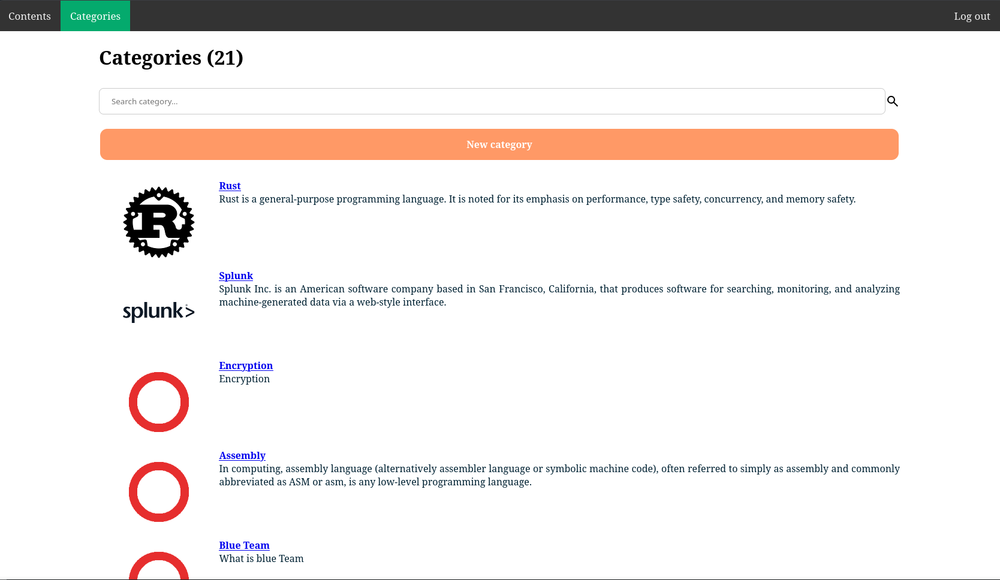
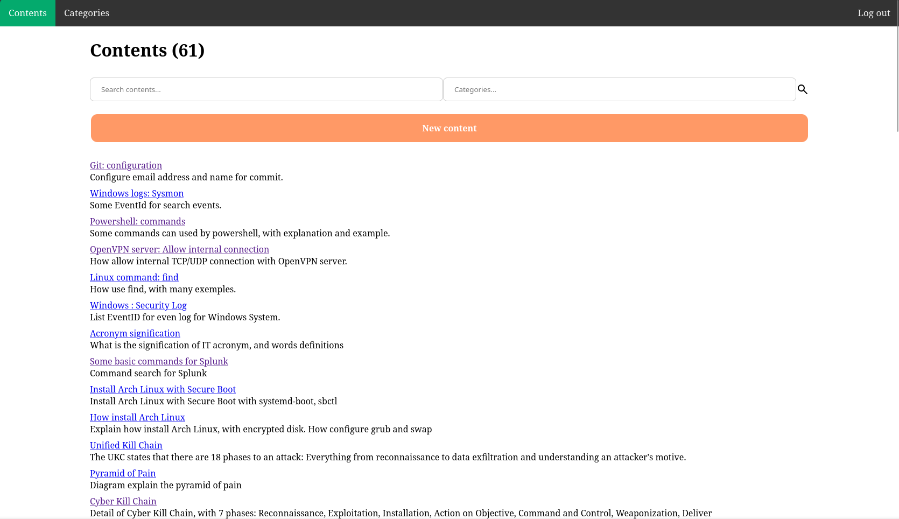
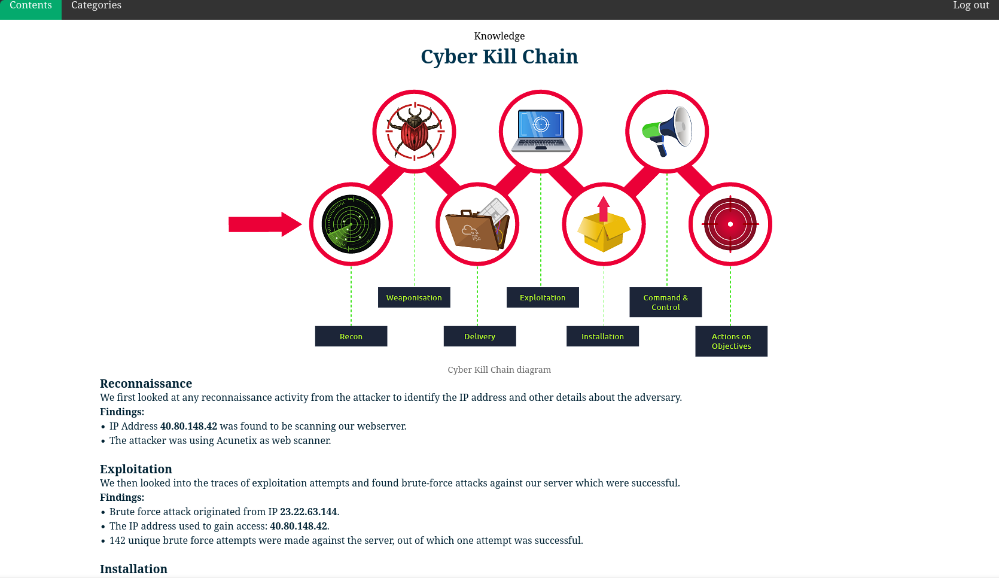

# What's is knowledge

Knowledge is a web-based application, allowing users to save content into categories.
This application allowed users to save data of learning days, like information on how networks work, or how to perform some basic attacks for cyber-security formation.

## Presentation

This web-based application has 2 main pages

- Categories
- Contents


### Categories

The categories are needed when we create content (will show after categories). The categories have many fields for the creation :

- id &rarr; string(36): id are string fields because the id is uuid unique
- slig &rarr; string(255): slug are used in url, replace `/categories/1` by `/categories/[:slug]`
- title &rarr; string(255): title of the category
- description &rarr; string(255): small description used the category root page for quick reading
- used_id &rarr; varchar(36): uuid of the user who created the category
- created_at &rarr; datetime: date of creation
- updated_at &rarr; datetime: last date of updating
- body: RoR framework can allow rich text editor without entering fields in the database, but the content is also present

**Render of the main categories page** (url: `/categories/`)

<p align="center">
    
</p>

### Contents

The content allow user to save information into categories. Like how use git, what is Cyber Kill Chain framework, and other...
The contents table have this following fields:

- id &rarr; string(36): id are string fields because the id is uuid unique
- slug &rarr; string(255): slug are used in url, replace `/contents/1` by `/contents/[:slug]`
- user_id &rarr; string(36): the uuid of the user who created the content
- content_type_id &rarr; string(36): the uuid of content type (knowledge | box)
- title &rarr; string(255): title of the content
- description &rarr; string(255): small description used the content root page for quick reading
- created_at &rarr; datetime: date of creation
- updated_at &rarr; datetime: last date of updating
- body: RoR framework can allow rich text editor without entering fields in the database, but the content is also present

**Render of the main contents page** (url: `/contents/`)

<p align="center">
    
</p>

**Render of one content** (url: `/contents/cyber-kill-chain`)

<p align="center">
    
</p>

## Framework

I used [Ruby on Rails](https://rubyonrails.org/) framework for the web-based application. This framework is based on MVC, Model, View, and Controller.

### Development

For development, the application runs on port 3000, URL `http://localhost:3000`.

### Production

The production running with socket, and a service created to launch the web application automatically when the server starts, or if the service crashes.


### Development and production variables

For both development and production, we need variables. [Ruby on Rails](https://rubyonrails.org/) framework does this with a credentials file. The file needs to be decrypted with the `master.key` file.

Content of this file, edit it with `EDITOR=vim rails credentials:edit` command:

```bash
secret_key_base: key_generate_automatically

database_development:
    usernane: username
    password: password
    host: host

database_production:
    usernane: username
    password: password
    host: host
```

### Service

To keep the web-based application running, create a service in the path `/etc/systemd/system/`.

```bash
[Unit]
Description="Knowledge Rails app"
After=network.target

[Service]
Type=simple
User=deploy
WorkingDirectory=/home/deploy/knowledge
Environment=RAILS_ENV="production"
Environment=RAILS_BIND="unix:///home/deploy/knowledge/tmp/sockets/puma.sock"
ExecStart=/home/deploy/.rbenv/shims/bundle exec puma -C /home/deploy/knowledge/config/puma.rb
Restart=always

[Install]
WantedBy=multi-user.target
```

## TODO

- [x] Create user with login process, password is encrypted with [bcrypt](https://en.wikipedia.org/wiki/Bcrypt)
- [x] Create categories CRUD
- [x] Create contents CRUD
- [x] Field search for categories and contents on the root page
- [x] If the user is not the creator of content or categories, he can't update or delete it
- [ ] Add page for updating user information, and deleting sessions.